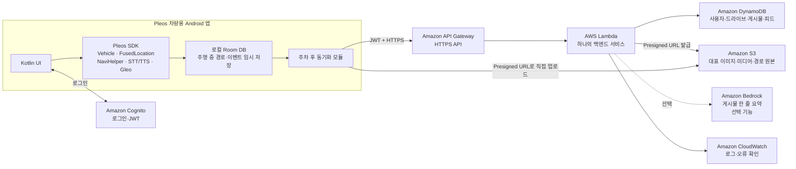
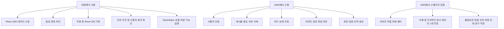
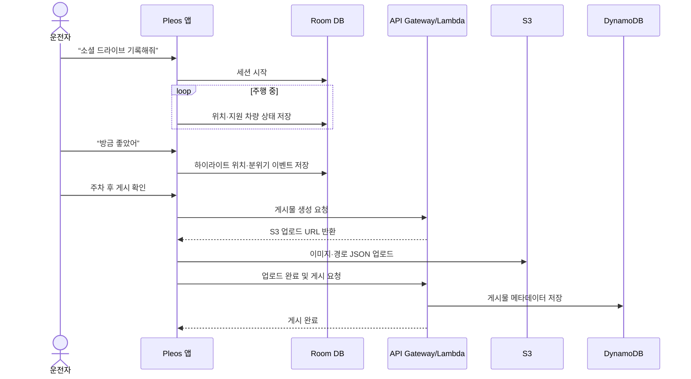

# 소셜 드라이브 AWS 최소 아키텍처

## 1. 결론

소셜 드라이브는 여러 사용자가 드라이브 기록을 게시하고 다른 사용자가 탐색·재생·따라 달리는 서비스이므로, Pleos SDK만으로는 완성되지 않는다. 최소한 다음 서버 기능이 필요하다.

- 사용자 식별 및 로그인
- 드라이브 세션과 게시물 저장
- 사진·하이라이트 등 미디어 업로드
- 피드 및 게시물 조회
- 다른 차량이 따라 달릴 경로·분위기 이벤트 조회

다만 주행 중 원시 데이터는 차량 안에 우선 저장하고, 주차 후 게시할 때 필요한 데이터만 AWS로 업로드한다. 차량 제어는 서버가 직접 수행하지 않고 Pleos 앱이 안전 조건을 확인한 뒤 로컬 SDK로 실행한다.

## 2. 공모전 MVP 범위

### 반드시 구현

1. 사용자가 로그인한다.
2. 음성으로 드라이브 기록을 시작한다.
3. 앱이 경로와 지원되는 차량 상태를 로컬에 기록한다.
4. 사용자가 “방금 좋았어”라고 말하면 현재 위치와 분위기 상태를 하이라이트 이벤트로 표시한다.
5. 주차 후 제목·대표 이미지·설명을 확인하고 게시한다.
6. 다른 사용자가 피드에서 드라이브 카드를 조회한다.
7. 게시물의 경유지를 NaviHelper로 넘겨 따라 달리기를 시작한다.
8. 하이라이트 구간에서 앱이 사용자에게 재현 여부를 묻고, 동의한 경우에만 지원되는 조명·창문 기능 등을 실행한다.

### 1차 MVP에서 제외하거나 모의 데이터로 시연

- 차량 카메라의 직전 30초 영상 자동 수집
- 현재 재생 중인 음악의 자동 추출 및 공유
- 차속 기반 기능
- 자율주행 주행감각 재현
- 추천 알고리즘, 정산, 광고 및 관광공사 관리자 기능

위 기능들은 현재 제안서에도 Pleos SDK 미지원 항목으로 적혀 있다. 실제 API가 없는 기능을 구현된 것처럼 표현하지 말고, 콘셉트 영상 또는 사전 준비한 데모 콘텐츠임을 표시해야 한다.

## 3. 최소 아키텍처



### 왜 이것이 최소인가

| 구성요소 | 필요한 이유 |
|---|---|
| Room DB | 주행 중 통신이 끊겨도 기록을 잃지 않고, 원시 데이터를 주차 전까지 차량 안에 보관한다. |
| Cognito | 게시물 소유자와 사용자를 식별한다. 자체 비밀번호 서버를 만들 필요가 없다. |
| API Gateway | 차량 앱에 인증된 HTTPS API 한 개를 제공한다. |
| Lambda | 별도 서버 운영 없이 게시·조회·권한 검증 로직을 처리한다. MVP에서는 하나의 모놀리식 Lambda로 시작한다. |
| DynamoDB | 사용자, 드라이브, 게시물과 피드 조회용 메타데이터를 저장한다. |
| S3 | 이미지, 데모 영상, 상세 경로 JSON처럼 큰 데이터를 저장한다. |
| CloudWatch | PT 시연 전에 서버 오류를 확인한다. |
| Bedrock | AI 요약이 필요할 때만 추가한다. 핵심 흐름에는 없어도 된다. |

CloudFront, OpenSearch, Step Functions, SQS, EKS, EC2, RDS는 초기 공모전 MVP에는 넣지 않는다.

## 4. 책임 분리



## 5. 핵심 처리 흐름

### 기록 및 게시



### 따라 달리기와 분위기 재현

1. 앱이 AWS에서 게시물의 경유지와 하이라이트 이벤트를 조회한다.
2. 경유지는 차량 앱이 NaviHelper에 전달한다.
3. 현재 위치가 하이라이트 반경에 들어오면 차량 앱이 재현 여부를 묻는다.
4. 사용자가 동의하고 차량·날씨·주행 안전 조건을 만족할 때만 로컬 Pleos SDK를 호출한다.
5. AWS는 재현할 이벤트 정보를 제공할 뿐 차량을 원격 제어하지 않는다.

## 6. 최소 API

| Method | Endpoint | 역할 |
|---|---|---|
| `POST` | `/drives` | 주차 후 드라이브 초안 생성 및 업로드 URL 발급 |
| `POST` | `/drives/{driveId}/publish` | 업로드 완료 후 게시 |
| `GET` | `/feed?cursor=...` | 최신 드라이브 카드 목록 조회 |
| `GET` | `/drives/{driveId}` | 경로·하이라이트·분위기 이벤트 상세 조회 |
| `PATCH` | `/drives/{driveId}` | 본인 게시물 제목·설명 수정 |
| `DELETE` | `/drives/{driveId}` | 본인 게시물 및 연결된 미디어 삭제 |
| `GET` | `/users/me` | 내 프로필 조회 |

좋아요, 댓글, 팔로우, 추천 API는 첫 시연 이후 추가한다.

## 7. 최소 데이터 모델

MVP에서는 DynamoDB 테이블 하나로 시작할 수 있다. 상세 경로 좌표 전체와 미디어는 S3에 저장하고 DynamoDB에는 조회용 요약만 둔다.

### User

```json
{
  "PK": "USER#u123",
  "SK": "PROFILE",
  "nickname": "바다러버",
  "createdAt": "2026-10-25T08:00:00Z"
}
```

### Drive/Post

```json
{
  "PK": "DRIVE#d456",
  "SK": "META",
  "ownerId": "u123",
  "status": "PUBLISHED",
  "title": "노을 해안도로, 둘이서",
  "summary": "숲길을 빠져나오면 바다가 열리는 코스",
  "distanceKm": 18.0,
  "durationMin": 42,
  "routeObjectKey": "drives/d456/route.json",
  "coverObjectKey": "drives/d456/cover.jpg",
  "highlightCount": 2,
  "createdAt": "2026-10-25T09:00:00Z"
}
```

### Feed index

- `GSI1PK = FEED#PUBLIC`
- `GSI1SK = 2026-10-25T09:00:00Z#d456`
- 무한 스크롤은 DynamoDB cursor로 처리한다.

### S3 route.json

```json
{
  "schemaVersion": 1,
  "route": [{"lat": 0.0, "lng": 0.0, "t": 0}],
  "waypoints": [{"lat": 0.0, "lng": 0.0}],
  "highlights": [
    {
      "at": {"lat": 0.0, "lng": 0.0},
      "radiusM": 100,
      "ambientColor": "#4A90E2",
      "windowPosition": 0,
      "requiresConfirmation": true
    }
  ]
}
```

## 8. 백엔드 핵심 로직

Lambda에는 다음 로직만 둔다.

1. Cognito JWT와 사용자 ID를 검증한다.
2. 게시물 소유권을 검증한다.
3. S3 Presigned URL을 발급한다.
4. 파일 형식·크기와 게시물 필수 필드를 검증한다.
5. 상세 경로 파일의 위치를 DynamoDB 게시물에 연결한다.
6. 공개 피드용 인덱스를 생성한다.
7. 삭제 시 DynamoDB와 연결된 S3 객체를 함께 삭제한다.
8. 선택적으로 Bedrock에 개인정보를 제거한 요약 데이터만 보내 한 줄 설명을 만든다.

## 9. 보안·개인정보 최소 원칙

- 모든 외부 통신은 HTTPS/TLS 1.2 이상을 사용한다.
- AWS Access Key와 Secret Key를 APK에 넣지 않는다.
- 앱은 Cognito 토큰만 사용하고 AWS 권한은 Lambda IAM Role에 둔다.
- S3 버킷은 비공개로 유지하고 짧은 유효기간의 Presigned URL만 발급한다.
- 정확한 위치와 차량 상태의 수집·전송·보유기간을 앱에서 고지하고 동의를 받는다.
- 서버에는 서비스에 필요한 최소 데이터만 보낸다.
- 원시 주행 데이터는 자동 업로드하지 않고 주차 후 게시 확정 시 업로드한다.
- 재현 이벤트에는 `requiresConfirmation`을 두고 서버가 차량 기능을 직접 실행하지 못하게 한다.
- CloudWatch 로그에는 위치, 토큰, 차량 상태 등 민감정보를 남기지 않는다.

## 10. 구현 순서

1. Pleos 앱에서 로컬 기록 → 주차 후 드라이브 카드 생성
2. Cognito 로그인과 API Gateway/Lambda 연결
3. DynamoDB 게시물 저장과 피드 조회
4. S3 대표 이미지·경로 JSON 업로드
5. NaviHelper를 이용한 따라 달리기
6. 안전 확인 후 하이라이트 분위기 재현
7. 시간이 남으면 Bedrock 한 줄 요약 추가

