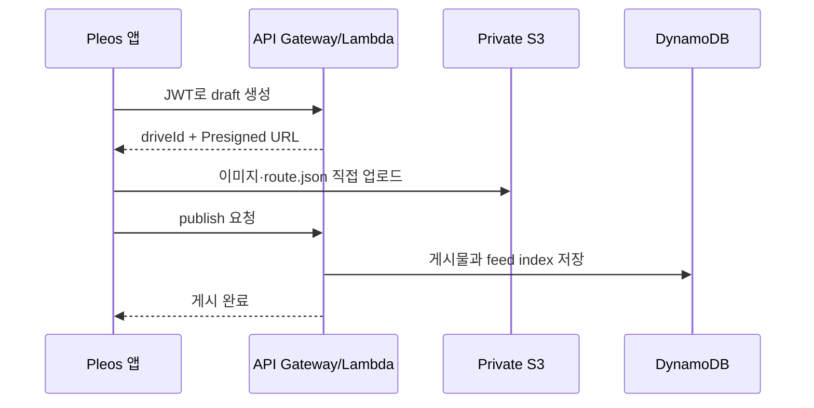

# 소셜 드라이브 개발 진행 순서

기준일: 2026-10-25  
접수 마감: 2026-11-15

## 먼저 지킬 원칙

1. 공식 문서와 Pleos Playground의 실제 프로젝트 상태를 최종 기준으로 삼는다.
2. 현재 사용 가능한 SDK만 필수 기능으로 잡는다.
3. 주행 중에는 짧고 단순한 UI와 음성·한 번의 터치만 허용한다.
4. 영상 재생, 게시물 편집, 로그인, 긴 텍스트 입력은 주차 중에만 허용한다.
5. 서버는 차량을 직접 제어하지 않는다. 차량 앱이 capability, 주행 규제, 사용자 동의를 확인한 후 로컬 SDK를 호출한다.
6. 정확한 위치와 차량 상태는 우선 로컬에 저장하고 사용자가 게시를 확정한 데이터만 서버로 전송한다.
7. APK에 AWS 비밀키, 관리자 키, 클라이언트 시크릿을 넣지 않는다.

## 현재 SDK 가용성에 따른 MVP 기준

Pleos의 프로젝트 생성 및 SDK 사용 신청 가이드에 표시된 현재 상태는 다음과 같다. 실제 Workspace > My Project 화면에서 다시 확인한다.

| 기능 | 현재 문서상 상태 | MVP 처리 |
|---|---|---|
| Vehicle State | 사용 가능 | 필수 후보. 필요한 읽기 API만 사용 |
| NaviHelper | 사용 가능 | 따라 달리기의 필수 기능 |
| Vehicle Control | 준비 중 | 필수 기능에서 제외, 승인되면 추가 |
| FusedLocation | 준비 중 | 필수 기능에서 제외, preset/mock 경로로 대체 가능 |
| SpeechToText | 준비 중 | 버튼 기반 기록으로 먼저 구현 |
| TextToSpeech | 준비 중 | 화면 안내로 먼저 구현 |
| Gleo Interface | 문서 제공 | 별도 사용·등록 조건 확인 후 후순위 적용 |

SDK가 준비 중이어도 앱의 전체 흐름은 완성되어야 한다. 공모전 시연에서는 `실제 SDK 동작`, `데모 데이터`, `향후 기능`을 명확히 구분한다.

## 전체 순서

```mermaid
flowchart LR
    A["0. 기능 동결"] --> B["1. Pleos 프로젝트·SDK 상태 확인"]
    B --> C["2. Android·Pleos AVD 설치"]
    C --> D["3. 공식 Sample App 검증"]
    D --> E["4. 앱 뼈대·안전 UX"]
    E --> F["5. 로컬 MVP 완성"]
    F --> G["6. AWS 최소 백엔드"]
    G --> H["7. 앱-AWS 연동"]
    H --> I["8. Pleos SDK 실제 연동"]
    I --> J["9. 보안·개인정보·주행 테스트"]
    J --> K["10. Release APK·영상·GitHub 제출"]
```



---

## 0단계 — 기능 범위 동결

### 이번 APK에서 반드시 되는 흐름

1. 테스트 사용자로 로그인한다.
2. `기록 시작` 버튼으로 드라이브 세션을 시작한다.
3. 경로와 지원 차량 상태를 Room DB에 저장한다.
4. `방금 좋았어` 버튼으로 하이라이트 이벤트를 남긴다.
5. 주차 상태에서 제목·대표 이미지·설명을 확인하고 게시한다.
6. 피드에서 다른 드라이브 게시물을 조회한다.
7. 게시물의 목적지·경유지를 NaviHelper로 전달한다.
8. 하이라이트 지점에서 재현 가능한 정보만 안내한다.

### 이번 APK 필수 범위에서 제외

- 차량 카메라 자동 녹화
- 현재 음악 자동 수집·재배포
- SDK 승인이 확인되지 않은 창문·조명 자동 제어
- 자율주행 제어
- 추천 AI, 댓글, 팔로우, 광고, 수익 정산

### 완료 기준

- 위 필수 흐름을 한 장의 화면 흐름도로 확정한다.
- 실제 기능과 데모 기능을 표로 분리한다.
- 팀원이 중간에 기능을 추가하지 않기로 합의한다.

---

## 1단계 — Pleos 계정·프로젝트·SDK 상태 확인

### 할 일

1. Pleos Playground에 가입한다.
2. Workspace > My Project에서 `소셜 드라이브` 프로젝트를 생성한다.
3. 카테고리와 앱 설명을 입력한다.
4. 프로젝트 ID를 팀 내부 보안 문서에 기록한다.
5. SDK 메뉴에서 각 기능의 상태를 캡처한다.
6. 사용 신청 가능한 SDK만 신청한다.
7. 팀원을 프로젝트 멤버로 초대한다.

### 주의

- Client Secret은 GitHub, APK, 화면 캡처에 포함하지 않는다.
- `준비 중` 또는 `제휴 계약 필요` SDK를 구현 완료 기능으로 기획서에 쓰지 않는다.
- SDK 사용 가능 여부는 문서보다 My Project의 현재 상태를 마지막으로 확인한다.

### 완료 기준

- 프로젝트가 생성되어 있다.
- `사용 가능 / 신청 중 / 준비 중` SDK 목록이 문서화되어 있다.
- MVP가 사용 가능한 SDK만으로도 시연 가능하다.

---

## 2단계 — 개발 환경 설치

현재 확인된 로컬 상태:

- Java 21 설치됨
- AWS CLI 설치됨
- Android Studio 미설치
- Android SDK·ADB 미설치

### 할 일

1. Android Studio 최신 안정 버전을 설치한다.
2. Pleos Sample App 기준에 맞춰 JDK 17을 준비한다.
3. Android SDK와 필요한 API를 설치한다.
4. Pleos Connect SDK Update Site를 등록한다.
5. `Pleos Connect v2.1.0` 시스템 이미지로 Automotive AVD를 만든다.
6. AVD RAM을 4GB로 설정하고 Cold Boot를 사용한다.
7. Virtual Console을 설치해 차량 상태를 변경할 수 있게 한다.

### 프로젝트 기준

- 언어: Kotlin
- 제품 앱 `minSdk`: 28 이상
- 빌드: Gradle Wrapper 사용
- 서명: debug와 release 분리
- 비밀 값: `local.properties` 또는 CI Secret 사용, Git 제외

### 완료 기준

- Pleos 전용 AVD가 정상 부팅된다.
- `adb devices`에 에뮬레이터가 보인다.
- 빈 APK를 설치하고 Launcher에서 실행할 수 있다.

---

## 3단계 — 공식 Sample App으로 SDK 검증

앱 개발을 먼저 시작하지 말고 Vehicle SDK Sample App과 NaviHelper 예제로 실제 동작 범위를 확인한다.

### Vehicle State 확인

1. SDK 초기화 여부를 확인한다.
2. 필요한 typed API별 capability를 확인한다.
3. 읽기 권한만 Manifest에 최소 선언한다.
4. 조회 결과와 listener 결과를 구분한다.
5. 화면 종료 시 listener를 해제하고 `Vehicle.release()`를 호출한다.

### 금지

- Sample App의 전체 permission 목록 복사
- capability 확인 없이 API 호출
- `Complete` 콜백만 보고 실제 차량 상태가 변경됐다고 판단
- 지원되지 않는 area에 동일한 동작을 가정

### 결과물

| 기능 | API | permission | capability | AVD 결과 | MVP 사용 |
|---|---|---|---|---|---|
| 예: 주행거리 | 확인 후 기재 | 확인 후 기재 | Supported/Unsupported | 값 | Yes/No |

### 완료 기준

- 소셜 드라이브에서 실제 사용하는 API만 확정된다.
- 사용 권한과 미지원 fallback이 정리된다.

---

## 4단계 — Android 앱 뼈대와 안전 UX

### 권장 모듈

```text
app
├── ui                 # Compose 화면
├── domain             # StartDrive, MarkHighlight, PublishDrive
├── data/local         # Room DB
├── data/remote        # AWS API client
├── integration/pleos  # Vehicle, NaviHelper, Gleo adapter
└── safety             # CarUxRestrictions, capability, confirmation
```

### 먼저 만들 화면

1. 홈/피드
2. 드라이브 상세
3. 기록 중 화면
4. 주차 후 게시 화면
5. 개인정보 동의 및 설정

### 안전 규칙

- `CarUxRestrictions`를 항상 확인한다.
- 주행 제한 상태에서는 키보드 입력, 게시물 수정, 영상, 긴 목록을 막는다.
- 주행 중 버튼은 `기록 시작/종료`, `하이라이트 표시` 수준으로 제한한다.
- 자동 애니메이션과 반복 화면 전환을 최소화한다.
- 차량 기능 실행 전 사용자 확인과 capability 확인을 모두 수행한다.

### 완료 기준

- 운전 상태와 주차 상태 UI가 다르게 동작한다.
- 모든 핵심 흐름을 SDK와 AWS 없이 fake repository로 실행할 수 있다.

---

## 5단계 — 로컬 MVP 완성

백엔드보다 먼저 로컬에서 전체 사용자 흐름을 완성한다.

### Room DB 최소 엔터티

- `DriveSession`
- `RoutePoint`
- `HighlightEvent`
- `DraftPost`
- `PendingUpload`

### 동작

1. 기록 중 데이터는 Room DB에 쌓는다.
2. 네트워크가 없어도 앱이 종료되거나 기록을 잃지 않는다.
3. 주차 후 게시를 누르면 `PendingUpload` 상태로 만든다.
4. 업로드 성공 전까지 로컬 원본을 삭제하지 않는다.

### 완료 기준

- 네트워크를 끈 상태에서 기록 → 초안 생성이 된다.
- 앱을 재시작해도 초안이 남는다.
- preset route로 피드 → 상세 → 따라 달리기 흐름이 된다.

---

## 6단계 — AWS 최소 백엔드

### 순서

1. 개발용 AWS 계정/리전을 확정한다.
2. Cognito User Pool을 만든다.
3. DynamoDB 테이블 하나를 만든다.
4. S3 비공개 버킷을 만든다.
5. Lambda 모놀리식 API를 만든다.
6. API Gateway HTTP API와 Cognito JWT Authorizer를 연결한다.
7. CloudWatch 로그와 알람을 설정한다.

### S3 필수 설정

- Block Public Access 전체 활성화
- Object Ownership: Bucket owner enforced
- 기본 암호화 활성화
- CORS는 실제 앱 요청에 필요한 범위만 허용
- Presigned PUT/GET URL은 짧게 만료
- 사용자와 drive ID가 포함된 객체 경로만 허용

### 최소 API

- `POST /drives`
- `POST /drives/{id}/publish`
- `GET /feed`
- `GET /drives/{id}`
- `PATCH /drives/{id}`
- `DELETE /drives/{id}`
- `GET /users/me`

### 완료 기준

- 테스트 JWT 없이 보호 API를 호출하면 401이 반환된다.
- 다른 사용자의 게시물을 수정·삭제할 수 없다.
- S3 객체 URL을 직접 열면 접근 거부된다.
- Presigned URL로 지정 객체만 제한 시간 동안 업로드된다.

---

## 7단계 — Android 앱과 AWS 연동

### 업로드 흐름



### 안전 처리

- exponential backoff와 업로드 재시도를 구현한다.
- API 로그에 JWT, 정확한 위치, 차량 원시 데이터를 남기지 않는다.
- Cognito 토큰 외 AWS 자격증명을 앱에 넣지 않는다.
- 업로드 파일 MIME, 크기, 객체 경로를 서버에서 재검증한다.

### 완료 기준

- 서로 다른 두 테스트 사용자로 게시·조회가 된다.
- 오프라인 초안이 네트워크 복구 후 업로드된다.
- 실패한 업로드를 중복 게시하지 않는다.

---

## 8단계 — Pleos SDK를 실제 기능에 연결

### 우선순위

1. Vehicle State 읽기
2. NaviHelper 목적지·경유지 연동
3. My Project에서 사용 가능할 경우 FusedLocation
4. 사용 가능할 경우 Gleo Interface 또는 STT/TTS
5. 승인과 안전성이 확인된 경우에만 Vehicle Control

### Adapter 원칙

앱 도메인이 Pleos SDK에 직접 의존하지 않도록 interface를 둔다.

```kotlin
interface VehicleContextProvider {
    suspend fun readSnapshot(): VehicleSnapshot?
}

interface NavigationLauncher {
    suspend fun startRoute(waypoints: List<Waypoint>): Result<Unit>
}
```

SDK 미지원 시 fake 구현으로 교체할 수 있어야 한다.

### 완료 기준

- SDK 연결 실패 시 앱 전체가 종료되지 않는다.
- capability가 없으면 해당 기능을 숨기거나 설명한다.
- listener와 SDK 리소스가 lifecycle 종료 시 해제된다.

---

## 9단계 — 카카오맵 사용 여부 결정

카카오맵은 `지도 시각화` 용도로만 검토하고 실제 차량 내비 실행은 NaviHelper를 사용한다.

### 도입 전 확인

- Kakao Android SDK가 Pleos AAOS 환경에서 정상 실행되는지
- Pleos 앱 카테고리와 외부 지도 표시가 심사상 허용되는지
- 패키지명과 debug/release 키 해시 등록
- 무료 쿼터와 과금 조건
- 지도 및 로고 표시 가이드 준수

### 안전한 기본안

확인 전에는 카카오맵을 핵심 의존성으로 만들지 않는다. 단순 경로 preview는 로컬 polyline 또는 정적 데모 화면으로 처리하고, 길 안내는 NaviHelper로 보낸다.

### 완료 기준

- 카카오맵을 제거해도 기록·게시·피드·따라 달리기가 동작한다.

---

## 10단계 — 개인정보·보안·주행 안전 검증

### 개인정보

- 수집 데이터: 계정, 위치, 차량 상태, 이미지
- 목적: 기록 생성, 게시, 경로 재현
- 보유기간과 삭제 방법 명시
- 게시 전 명시적 동의
- 동의 철회와 계정/게시물 삭제 구현
- 위치정보 관련 약관 필요 여부 확인

### 보안

- HTTPS/TLS 1.2 이상
- 민감정보 로그 금지
- S3 Public Access 차단
- IAM 최소 권한
- 소스와 APK에 비밀키 없음
- release에서 `debuggable=false`
- WebView 원격 디버깅 비활성화
- 의존성 취약점 확인

### 차량 안전

- 주행 중 영상 재생 금지
- 주행 중 긴 입력·편집 금지
- CarUxRestrictions 테스트
- capability와 area 확인
- 차량 기능 실행 전 명시적 확인
- 네트워크·SDK 실패 시 안전한 fallback

### 완료 기준

- 체크리스트의 실패 항목이 0개다.
- 심사자가 사용할 테스트 계정과 기능 설명이 준비되어 있다.

---

## 11단계 — Release와 제출

### 빌드

1. release signing key를 안전하게 보관한다.
2. `assembleRelease`로 APK를 만든다.
3. 새 Pleos AVD에 release APK를 처음부터 설치한다.
4. 앱 실행, 로그인, 게시, 조회, NaviHelper 흐름을 다시 검사한다.
5. 크래시와 네트워크 실패를 검사한다.

### GitHub

- `apk/팀명_소셜드라이브_release.apk`
- 소스 코드
- 실행 방법
- 테스트 환경과 SDK 버전
- 사용한 SDK와 권한
- AWS 배포 방법 또는 시연 서버 정보
- 데모/미지원 기능 구분
- 오픈소스 라이선스
- APK 위치

### 영상

1. 문제 상황
2. 음성 또는 버튼으로 기록
3. 주차 후 자동 초안
4. 피드에서 탐색
5. NaviHelper로 따라 달리기
6. 실제 SDK와 향후 기능을 구분해 설명

### 완료 기준

- 빈 환경에서 README만 보고 APK 실행이 가능하다.
- 심사 계정과 서버가 심사 기간 동안 활성화되어 있다.
- 제출 APK와 GitHub의 소스 버전이 일치한다.

## 권장 일정

| 날짜 | 목표 |
|---|---|
| 10/25–10/27 | 0–2단계: 범위 동결, Pleos 프로젝트, 개발 환경 |
| 10/28–10/30 | 3단계: Sample App과 SDK capability 확인 |
| 10/31–11/03 | 4–5단계: 안전 UX와 로컬 MVP |
| 11/04–11/07 | 6–7단계: AWS와 앱 연동 |
| 11/08–11/10 | 8–9단계: Pleos SDK, 지도 검증 |
| 11/11–11/12 | 10단계: 보안·개인정보·주행 테스트 |
| 11/13–11/14 | 11단계: Release APK, 영상, GitHub, 서류 |
| 11/15 | 제출 버퍼, 새 기능 추가 금지 |

## 아키텍처 이미지 수정 사항

현재 `image.png`에 다음 연결과 구성요소를 추가해야 한다.

1. Android 앱 내부에 `Room DB / Offline Queue` 추가
2. `Android App → Cognito → JWT → API Gateway` 인증 흐름 표시
3. `API Gateway → Lambda → DynamoDB` 연결
4. `Lambda → 앱: Presigned URL`, `앱 → S3: HTTPS upload` 연결
5. S3에 `Private / Block Public Access` 표시
6. Vehicle SDK를 `Vehicle State`와 `Vehicle Control`로 분리하고 현재 가용 상태 표시
7. FusedLocation, STT/TTS, Gleo를 실제 사용 승인 확인 전에는 점선/Optional로 표시
8. Kakao Maps는 `지도 시각화(검증 필요)`, NaviHelper는 `차량 내비 연동`으로 역할 분리
9. AWS에서 Vehicle SDK로 직접 이어지는 제어 화살표는 만들지 않음

